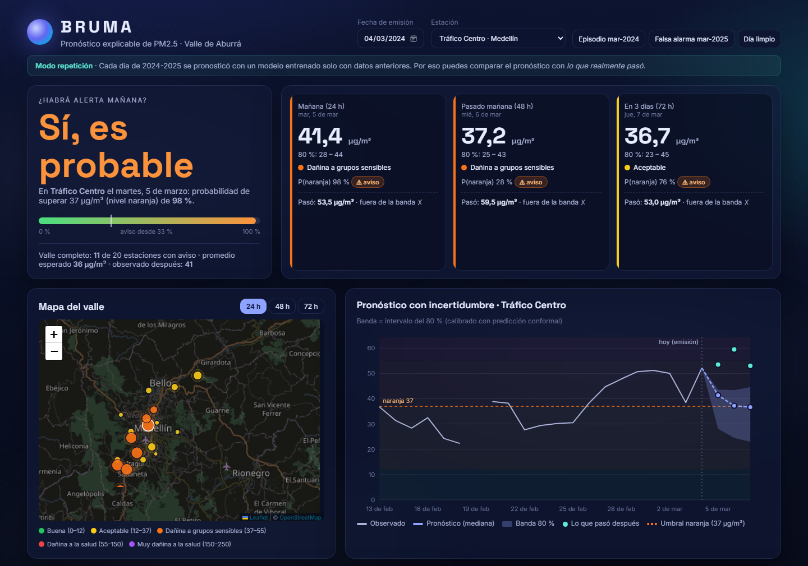
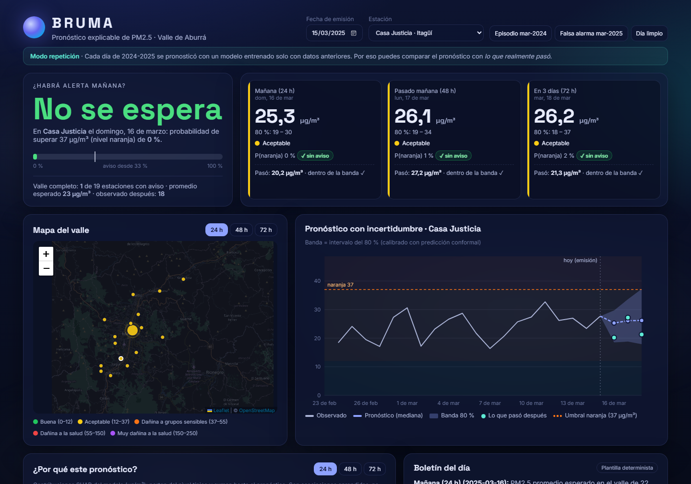
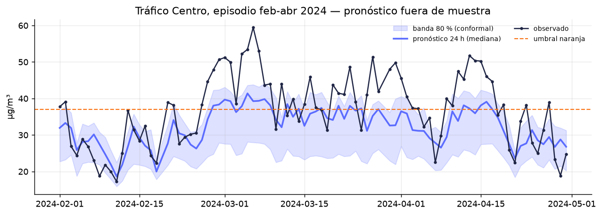
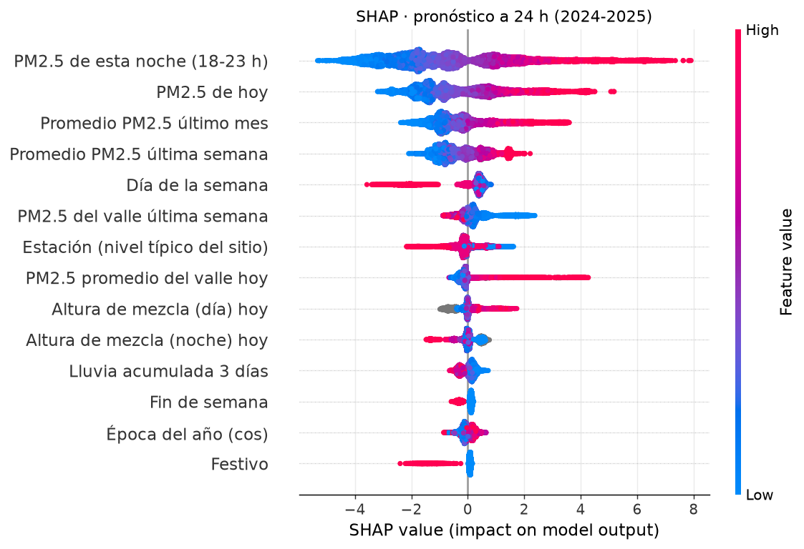
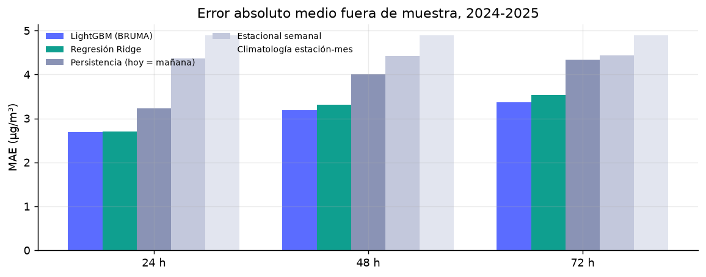
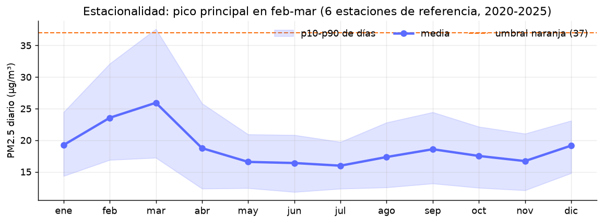
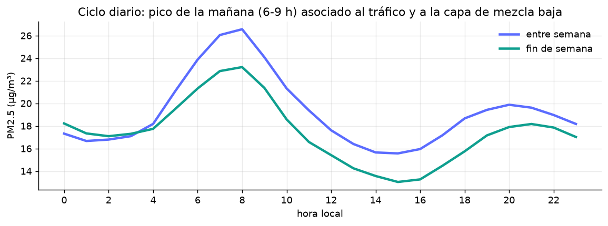
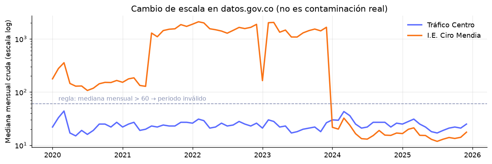
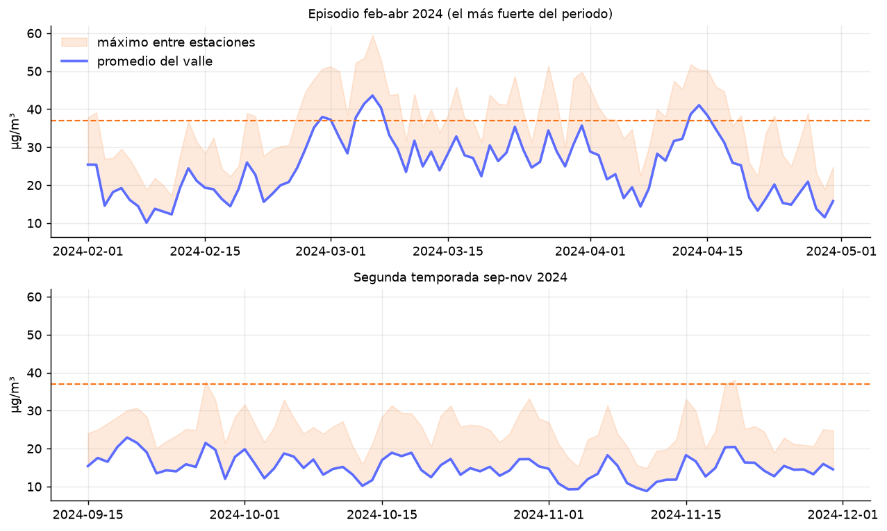

# BRUMA · Pronóstico explicable de calidad del aire

[](https://github.com/saracastrillons/bruma/actions/workflows/ci.yml)

**¿Habrá alerta mañana en el Valle de Aburrá?** BRUMA pronostica el PM2.5 (promedio de 24 h) de 20 estaciones de Medellín y su área metropolitana a **24, 48 y 72 horas**, con una **banda de incertidumbre calibrada**, la **probabilidad de llegar a nivel naranja** y una **explicación SHAP** de cada pronóstico. Todo con datos públicos reales y una evaluación sin fuga de información.



| El modelo también se equivoca: falsa alarma de marzo 2025 | Pronóstico fuera de muestra del episodio de marzo 2024 |
|---|---|
|  |  |
| **¿Qué usa el modelo? (SHAP, 24 h)** | **Error frente a las líneas base** |
|  |  |

## Resultados (fuera de muestra, 2024-2025)

| | 24 h | 48 h | 72 h |
|---|---|---|---|
| **MAE BRUMA** (µg/m³) | **2,69** | **3,19** | **3,37** |
| MAE persistencia (mañana = hoy) | 3,23 | 4,01 | 4,34 |
| Mejora frente a la persistencia | −17 % | −20 % | −22 % |
| R² | 0,76 | 0,65 | 0,60 |
| Cobertura de la banda del 80 % (conformal) | 82 % | 83 % | 84 % |
| ROC-AUC de la alerta naranja | 0,98 | 0,94 | 0,94 |

13.187 pronósticos estación-día por horizonte. Cada año se predijo con un modelo entrenado **solo con años anteriores**; los hiperparámetros y el umbral de alerta se eligieron con 2022-2023 y nunca miraron 2024-2025. Las limitaciones (subestima los picos, la alerta detecta solo 31 % de los días naranja a 24 h) están en el **[model card](MODEL_CARD.md)**.

## ¿Qué hace?

- **Pipeline de datos real y documentado**: descarga el PM2.5 horario de la red AMVA/SIATA (datos.gov.co) y la meteorología ERA5 (Open-Meteo), lo cachea y lo limpia con reglas contadas una por una en `artifacts/data_quality.json`.
- **Detecta un problema de la fuente oficial**: 14 estaciones publican entre 2020 y 2023 valores que no están en µg/m³ (medianas de hasta 2.000). Lo confirmé cruzando con el archivo propio de SIATA: desde 2024 coinciden 1:1 (correlación 1,0), antes no. Una regla automática descarta esos periodos (44 % de las filas).
- **Líneas base honestas**: persistencia, estacional semanal, climatología y una regresión Ridge con las mismas variables.
- **LightGBM de cuantiles** (0,1 · 0,5 · 0,9) más un **clasificador de nivel naranja**, un modelo directo por horizonte.
- **Validación temporal por años sin fuga**, con una prueba automática que altera el futuro y verifica que ninguna variable cambia.
- **Predicción conformal (CQR)**: los cuantiles crudos cubrían solo 68 %; recalibrados con residuos de años anteriores llegan a 82-84 %.
- **Explicabilidad**: SHAP exacto por pronóstico (las contribuciones suman la predicción) e importancia global por horizonte.
- **Ablación**: probé darle al modelo la meteorología del día pronosticado (como un pronóstico del tiempo perfecto). Ayudó en 2022-2023 pero no en 2024-2025, así que el modelo final no la usa.
- **API FastAPI** con pronósticos, explicaciones, mapa del valle y métricas; documentación automática en `/docs`.
- **Tablero en español**: "¿habrá alerta mañana?", mapa de estaciones, gráfica con bandas, SHAP en barras divergentes y comparación con lo que realmente pasó.
- **Boletín con IA anclado a los datos** (opcional): Gemini redacta solo con las salidas del modelo. Si inventa un número, el texto se descarta y se usa una plantilla determinista. Sin clave, siempre funciona con la plantilla.

## Arquitectura

```
datos.gov.co (AMVA/SIATA) ─┐
SIATA (contraste) ─────────┼─► download_data.py ─► data/raw (caché)
Open-Meteo ERA5 ───────────┘                          │
                                                      ▼
                                   build_dataset.py: limpieza + promedios diarios
                                                      │
                                                      ▼
                     train.py: variables ─► LightGBM (cuantiles + clasificador)
                               validación por años · conformal · SHAP
                                                      │
                                                      ▼
                         artifacts/ (pronósticos, SHAP, métricas)
                                                      │
                        FastAPI ─► tablero  ·  boletín (plantilla / Gemini)
```

| Archivo | Rol |
|---|---|
| `bruma/sources.py` | Descarga y caché de las tres fuentes |
| `bruma/clean.py` | Reglas de limpieza y agregación diaria |
| `bruma/features.py` | Variables sin fuga (todo hasta el día de emisión) |
| `bruma/models.py` | Líneas base, LightGBM, conformal y métricas |
| `bruma/bulletin.py` | Hechos del modelo, plantilla, Gemini y verificación de cifras |
| `bruma/service.py` · `bruma/api/app.py` | Capa de datos y API |
| `bruma/api/static/` | Tablero (HTML + JS sin build, Leaflet) |
| `notebooks/01_eda.ipynb` | Calidad de datos, estacionalidad, ciclo diario, mapa, episodios |
| `notebooks/02_modelo.ipynb` | Métricas, incertidumbre, alerta, SHAP |

## Lo que dicen los datos

| Estacionalidad | Ciclo diario |
|---|---|
|  |  |
| **Cambio de escala en la fuente** | **Episodios** |
|  |  |

- Marzo es el mes más contaminado. La "segunda temporada" de octubre casi no se ve en 2020-2025.
- Hay un pico a las 7-8 a. m. y los domingos el nivel baja ~17 % frente al promedio entre semana.
- Tráfico Centro pasa 8,8 % de los días en naranja. Santa Elena, a 2.580 m, tiene la mitad del nivel del fondo del valle.
- La meteorología de un solo punto ERA5 se correlaciona muy poco con el PM2.5 diario (|ρ| ≤ 0,17).

Son **asociaciones**, no causas.

## Ejecutar en local

**Opción rápida (Windows):** doble clic en `start.bat` y abre http://127.0.0.1:8077.

**Manual:**

```bash
python -m venv .venv
.venv\Scripts\activate          # Linux/Mac: source .venv/bin/activate
pip install -r requirements.txt
uvicorn bruma.api.app:app --port 8077
```

El repositorio ya trae los datos procesados y los artefactos del modelo. Para reproducir todo desde cero:

```bash
pip install -r requirements-dev.txt
python scripts/download_data.py   # ~50 MB de datos crudos
python scripts/build_dataset.py
python scripts/train.py           # ~4 min
pytest -q
```

**Boletín con Gemini (opcional):** copia `.env.example` como `.env` y pon tu `GEMINI_API_KEY`. El archivo `.env` está en `.gitignore`.

**Docker:**

```bash
docker build -t bruma .
docker run -p 8077:8077 bruma
```

## API

| Ruta | Devuelve |
|---|---|
| `GET /api/meta` | Estaciones, fechas disponibles, bandas ICA, resumen de métricas |
| `GET /api/forecast?station=29509&date=2024-03-04` | 24/48/72 h con banda, P(naranja), SHAP y lo observado |
| `GET /api/valley?date=2024-03-04&h=1` | Pronóstico de todas las estaciones (mapa) |
| `GET /api/bulletin?date=2024-03-04` | Boletín y los hechos con que se redactó |
| `GET /api/metrics` | Métricas completas y reporte de calidad de datos |
| `GET /docs` | Documentación interactiva (OpenAPI) |

El tablero acepta enlaces directos: `/?fecha=2024-03-04&estacion=29509`.

## Stack

Python · pandas · LightGBM · scikit-learn · SHAP · FastAPI · Leaflet · Gemini (opcional) · pytest · GitHub Actions · Docker

## Datos y créditos

- PM2.5: red de monitoreo del Área Metropolitana del Valle de Aburrá operada por SIATA, publicada por IDEAM (SISAIRE) en [datos.gov.co](https://www.datos.gov.co/resource/g4t8-zkc3).
- Meteorología: reanálisis ERA5 de Copernicus vía [Open-Meteo](https://open-meteo.com).
- Mapa base: © colaboradores de [OpenStreetMap](https://www.openstreetmap.org/copyright).

BRUMA es un proyecto de portafolio. **No reemplaza los pronósticos ni las alertas oficiales de SIATA.**

---

Hecho por **Sara Castrillón Sánchez** · [github.com/saracastrillons](https://github.com/saracastrillons)
